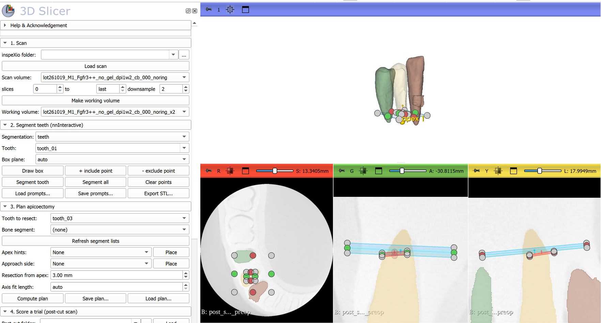

# inspeXio 3D Teeth Segmentation

Segment every tooth, crown and roots, in a Shimadzu inspeXio micro-CT scan, and display the teeth as
surface models in [3D Slicer](https://www.slicer.org). Segmentation uses
[nnInteractive](https://github.com/MIC-DKFZ/nnInteractive), a promptable 3D segmentation model, with one box
prompt per tooth.


## Why a promptable model

In the specimens this was built for, the teeth sit in an embedding base of almost the same density as
dentin. Only the enamel is clearly brighter, and the roots are separated from the base by a thin dark
outline. Thresholding therefore finds only the crowns. Dental models trained on clinical CBCT
(CBCTToothSegmentation, for example) expect a bright tooth in darker tissue, and they labelled the base as
tooth. nnInteractive segments the object a prompt points at and follows the root outline. The
[History of discovery](https://github.com/nobyhata/inspeXio-3D-Teeth-Segmentation/wiki/History-of-discovery)
on the wiki explains the steps that led here.

## Requirements

- 3D Slicer 5.12 (tested with 5.12.4 on Windows) with the **PyTorch** extension and a CUDA build of torch.
- The nnInteractive Python package, installed once in Slicer's Python console:
  `slicer.util.pip_install("nninteractive")`.
- An NVIDIA GPU. Tested on an RTX 3060 (12 GB) at 0.089 mm voxels.
- The scan loaded as NRRD. Use
  [Shimadzu-inspeXio-converter-for-3D-Slicer](https://github.com/nobyhata/Shimadzu-inspeXio-converter-for-3D-Slicer)
  to turn the inspeXio `.cb` slice folder into an `.nhdr` file. That repository also covers volume rendering.

The model weights (nnInteractive v1.0) download automatically on first use. They are licensed
**CC BY-NC-SA 4.0**, so commercial use is not permitted.

## The InspeXio Teeth module

`slicer/InspeXioTeeth` is a 3D Slicer module that puts the whole workflow in one panel, from the inspeXio
scan folder to a scored apicoectomy trial. Install it once: **Edit → Application Settings → Modules →
Additional module paths**, add the `slicer/InspeXioTeeth` folder, and restart Slicer. It appears under
**Segmentation → InspeXio Teeth**.



1. **Scan.** Pick the inspeXio folder and press *Load scan* (the `.nhdr` header is written next to the
   slices, nothing is copied). Set the slice range that holds the teeth and the downsampling (2 suits a
   12 GB GPU), then *Make working volume*.
2. **Segment teeth.** Type a tooth name, press *Draw box* and click two corners on a slice through the
   tooth, from the crown tip to just past the root apex. *Segment tooth* runs nnInteractive. If the result
   spills into the base, add *− exclude points* on the spill and segment again; *+ include points* add a
   missed part. Prompts are saved and reloaded as JSON (*Save prompts…* / *Load prompts…*); the voxel-box
   files from `nninteractive_teeth.py` load too. *Segment all* re-runs every tooth.
3. **Plan apicoectomy.** Choose the tooth to resect. For a single-rooted tooth the apex is found
   automatically; for a molar, place one *apex hint* near each root apex. *Compute plan* marks each apex,
   fits the root axis over the apical part of the root, and places the resection plane perpendicular to it
   at the set distance (3 mm by default). With a bone segment, it also marks the planned bone-entry point,
   the nearest point on the outer surface of the jaw (an *approach side* point restricts it to, say, the buccal
   side). Plans are saved as JSON so a trial can be scored in a later session.
4. **Score a trial.** Scan the model again after the cut and load that scan. *Score trial* registers it
   rigidly to the pre-op scan (within a 1 mm margin around the segments), resamples it onto the pre-op grid
   and measures, per root: the resection level along the planned axis, the angle between the cut face and
   the plane perpendicular to the axis, whether the apex was removed, tooth left apical to the cut, any
   other tooth that lost material (wrong-tooth cut), and, with a bone segment, the bone-window centre and its
   distance from the planned entry. Trial ID, operator, condition, number of checks and time are typed in,
   and every root becomes one row of the results CSV, with a pass flag for "no wrong tooth, entry within
   2 mm, at most 2 checks".

A voxel counts as removed when it was clearly tooth (or bone) in the pre-op scan and is near the air value
in the post-cut scan, so the root canal and partial-volume edges never count, and thin dark rims left by a
residual registration error are ignored. The threshold is set automatically from the air and tooth grey
values; set it by hand if the cut space is filled with water or embedding material.

Checked on synthetic teeth (two-rooted molar, noise, zero padding, a one-voxel misregistration, a dark
canal) with `Testing/test_geometry.py`, and in Slicer 5.12.4 on the example scan with a simulated
8°-tilted cut moved by 0.3 mm and 2°: registration residual 0.006 mm, cut angle 7.7°, no false wrong-tooth
flag, and a deliberate nick on the neighbouring tooth flagged. The angle resolution is roughly the voxel
size divided by the root diameter at the cut (about 1° for a 5 mm root at 0.089 mm).

## Script usage

1. Write one prompt per tooth in a `.json` file: a 2D box on a vertical plane through the tooth, from the
   crown tip to just past the root apex, in voxel coordinates `[[k0, k1], [j0, j1], [i0, i1]]` of the
   2×-downsampled volume. Optional `"exclude"` / `"include"` points correct a spill or a missed part.
   `examples/teeth_boxes_lot261019.json` is the complete set for the example scan.
2. Set `VOLUME_PATH`, `SLICES`, `TEETH_JSON` and `EXPORT_DIR` at the top of `slicer/nninteractive_teeth.py`.
3. In Slicer, open **View → Python Console** and run:

   ```python
   exec(open(r"C:\path\to\nninteractive_teeth.py").read())
   ```

Each tooth becomes its own segment and surface. Each one takes about 3–5 s after the model has loaded.
With `EXPORT_DIR` set, the script writes one STL per tooth.


The [wiki](https://github.com/nobyhata/inspeXio-3D-Teeth-Segmentation/wiki) has the step-by-step guide,
with how to choose boxes, how to fix a spill and how to check the result.

## Example result

Scan `lot261019_M1_Fgfr3++_no_gel_dpi1w2_cb_000` (1024 × 1024 × 880, 0.0444 mm), slices 0–600: nine teeth,
crown and roots, with exclusion points needed for two of them. The crowns of the front teeth lie beyond the
scanned volume, so those teeth end flat at the top.


