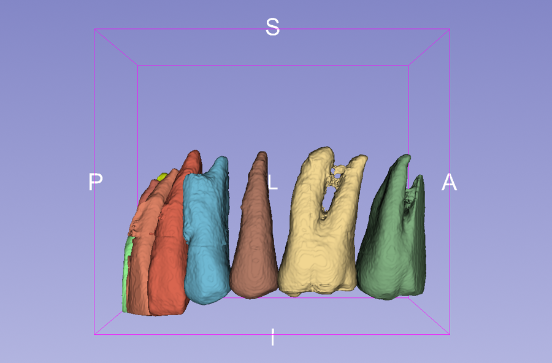
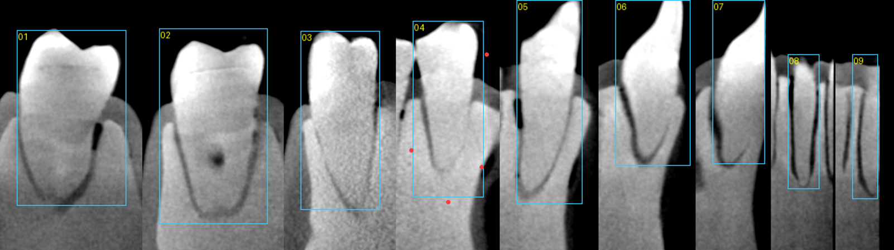
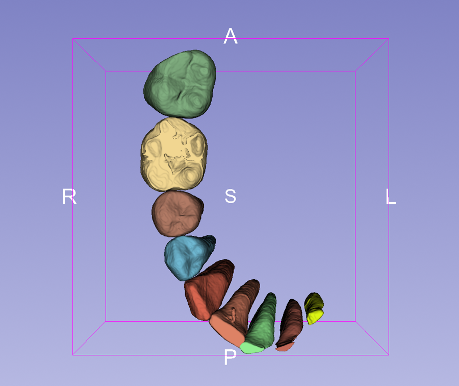

# inspeXio 3D Teeth Segmentation

Segment every tooth, crown and roots, in a Shimadzu inspeXio micro-CT scan, and display the teeth as
surface models in [3D Slicer](https://www.slicer.org). Segmentation uses
[nnInteractive](https://github.com/MIC-DKFZ/nnInteractive), a promptable 3D segmentation model, with one box
prompt per tooth.



## Why a promptable model

In the specimens this was built for, the teeth sit in an embedding base of almost the same density as
dentin. Only the enamel is clearly brighter, and the roots are separated from the base by a thin dark
outline. Thresholding therefore finds only the crowns. Dental models trained on clinical CBCT
(CBCTToothSegmentation, for example) expect a bright tooth in darker tissue, and they labelled the base as
tooth. nnInteractive segments the object a prompt points at and follows the root outline. The
[History of discovery](https://github.com/nobyhata/inspeXio-3D-Teeth-Segmentation/wiki/History-of-discovery)
on the wiki explains the steps that led here.

## Requirements

- 3D Slicer 5.12 (tested with 5.12.4 on Windows) with the **PyTorch** extension and a CUDA build of torch.
- The nnInteractive Python package, installed once in Slicer's Python console:
  `slicer.util.pip_install("nninteractive")`.
- An NVIDIA GPU. Tested on an RTX 3060 (12 GB) at 0.089 mm voxels.
- The scan loaded as NRRD. Use
  [Shimadzu-inspeXio-converter-for-3D-Slicer](https://github.com/nobyhata/Shimadzu-inspeXio-converter-for-3D-Slicer)
  to turn the inspeXio `.cb` slice folder into an `.nhdr` file. That repository also covers volume rendering.

The model weights (nnInteractive v1.0) download automatically on first use. They are licensed
**CC BY-NC-SA 4.0**, so commercial use is not permitted.

## Usage

1. Write one prompt per tooth in a `.json` file: a 2D box on a vertical plane through the tooth, from the
   crown tip to just past the root apex, in voxel coordinates `[[k0, k1], [j0, j1], [i0, i1]]` of the
   2×-downsampled volume. Optional `"exclude"` / `"include"` points correct a spill or a missed part.
   `examples/teeth_boxes_lot261019.json` is the complete set for the example scan.
2. Set `VOLUME_PATH`, `SLICES`, `TEETH_JSON` and `EXPORT_DIR` at the top of `slicer/nninteractive_teeth.py`.
3. In Slicer, open **View → Python Console** and run:

   ```python
   exec(open(r"C:\path\to\nninteractive_teeth.py").read())
   ```

Each tooth becomes its own segment and surface. Each one takes about 3–5 s after the model has loaded.
With `EXPORT_DIR` set, the script writes one STL per tooth.



The [wiki](https://github.com/nobyhata/inspeXio-3D-Teeth-Segmentation/wiki) has the step-by-step guide,
with how to choose boxes, how to fix a spill and how to check the result.

## Example result

Scan `lot261019_M1_Fgfr3++_no_gel_dpi1w2_cb_000` (1024 × 1024 × 880, 0.0444 mm), slices 0–600: nine teeth,
crown and roots, with exclusion points needed for two of them. The crowns of the front teeth lie beyond the
scanned volume, so those teeth end flat at the top.


