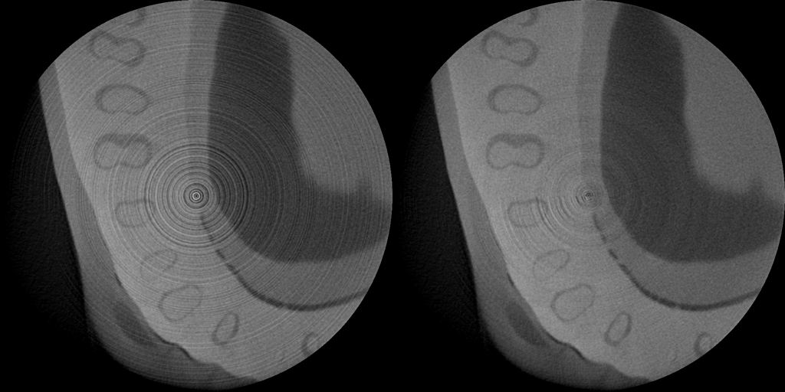
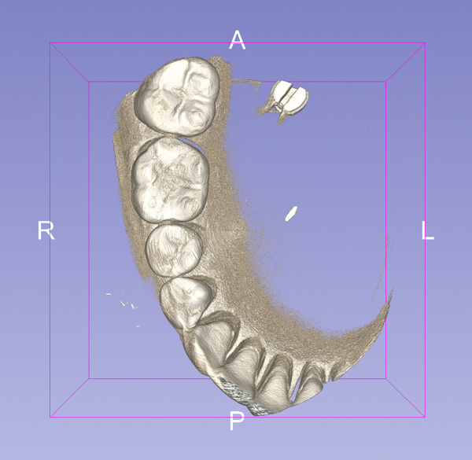
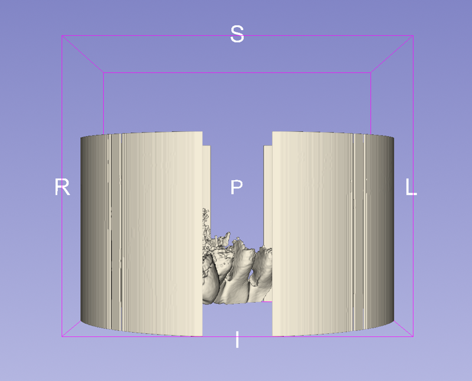
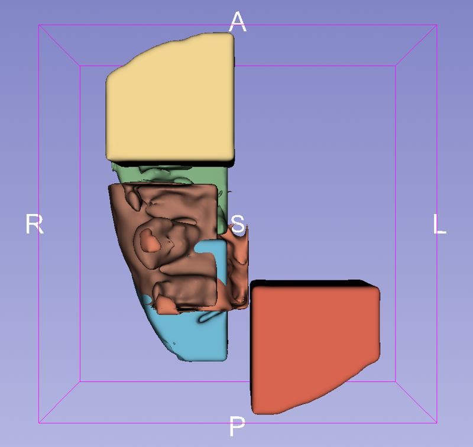
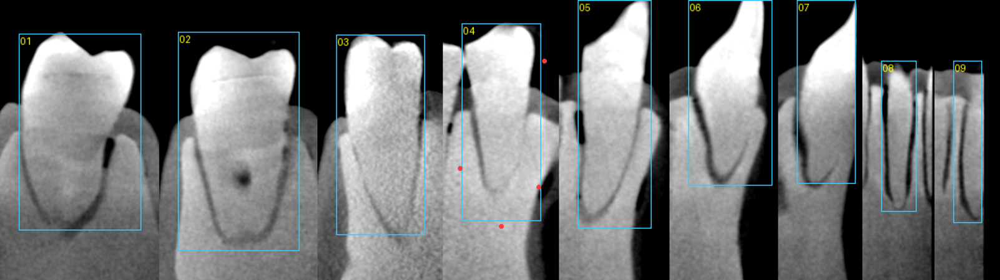
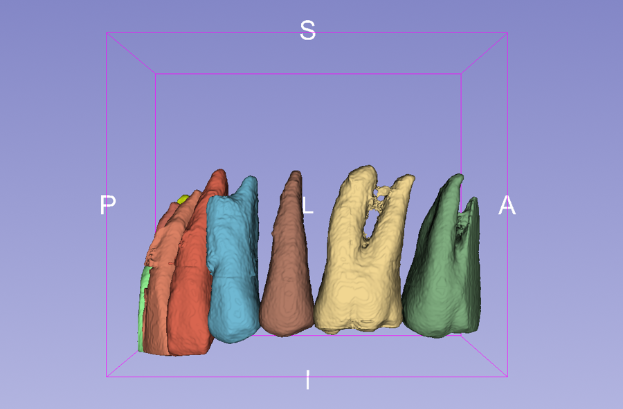

This page records how this repository and its companion, [Shimadzu-inspeXio-converter-for-3D-Slicer](https://github.com/nobyhata/Shimadzu-inspeXio-converter-for-3D-Slicer), came about. It all happened in one working session on 5 November 2026, beginning with a folder of micro-CT images and the simple wish to see them in 3D Slicer, and ending with each tooth segmented as its own surface model. The dead ends are kept as well, because they explain why the final method looks the way it does.

## 1. A folder that Slicer could not read

The starting point was a scan folder, `lot261019_M1_Fgfr3++_no_gel_dpi1w2_cb_000`, holding 880 numbered `.cb` files together with `.inf` and `.prm` files for each slice, plus a second reconstruction in `noring_0000`. Slicer did not recognise the `.cb` extension. When we opened the files byte by byte, however, they turned out to be ordinary uncompressed 16-bit TIFF images of 1024 × 1024 pixels, each with a 1,372-byte header in front of the pixel data. The pixel size, 0.0443945 mm, was written in `0000.txt`. A screenshot saved by the scanner (`CaptureImage.jpg`) then identified the instrument as a Shimadzu inspeXio and confirmed isotropic voxels, since its 39.1 mm field of view along Z divided by 880 slices gives the same 0.044 mm.

Because every slice had the same layout, no conversion was needed at all: a few-kilobyte NRRD header that lists the 880 slice files and skips their TIFF headers is enough for Slicer to load the whole volume directly. We compared the two reconstructions on the middle slice and found that `noring_0000` is the ring-artifact-corrected one, so it became the default.

That one-off header was then generalised into `cb2nrrd.py`. The script reads the image size, bit depth, header offset and voxel size from the files themselves, so it works on any inspeXio reconstruction folder, and it was published as the converter repository.

## 2. Getting the volume rendering right

The first volume rendering showed a solid cylinder rather than teeth. inspeXio grey values are scanner units, not Hounsfield units, so Slicer's CT presets did not apply, and our first opacity cutoff was low enough to make the whole field of view opaque. Raising the cutoff to 38,800 went too far in the other direction, and the teeth came out as fragments. Only after measuring the slice that contained the teeth did the picture become clear: the background sits near 34,700, the soft material near 37,200, and the teeth between 38,100 and 39,800, so a cutoff of 37,800 shows whole teeth. Even then the teeth were hidden behind bone of the same density until we turned the camera to look from below, onto the biting surfaces.

To be sure the settings were reproducible, we rebuilt the view from an empty Slicer scene with a single script, `render_in_slicer.py`. That run exposed one more detail, because the model came up too small until a zoom-to-fit step was added.

## 3. Thresholding: crowns, but not roots

The next goal was to segment the teeth rather than only render them. A threshold at the enamel level (about 38,800), a morphological opening to remove the thin wall of the sample tube, and a slice range that left out the holder at the bottom worked well on a reduced copy of the scan. At full resolution, however, the result contained a large cylindrical shell, and this led to a second discovery about the data: the reconstruction has a thin bright rim at the very edge of its circular field of view.

The rim can be masked out, but a more fundamental limit remained. The teeth in this specimen are embedded in a base material of almost the same density as dentin, so only the enamel stands out by grey value, and the roots are separated from the base by nothing more than a thin dark outline. Thresholding therefore gives the crowns and can never give the roots.

## 4. Dental AI models trained on clinical CBCT

We then tried the Kitware extension **CBCTToothSegmentation**, which runs a deep-learning model inside a box drawn around each tooth. Getting it to run at all took several fixes. It needed the PyTorch extension and a CUDA build of torch, and the MONAI version it pins (1.3.0) does not import on the Python 3.12 that Slicer 5.12 uses, so we installed a newer MONAI and stopped the extension from downgrading it. Its model also pads every box to 144 voxels by mirroring, which fails when a box is too small, and since the model does not resample and was trained on clinical voxels several times larger than ours, the scan had to be resampled first. We tried 0.15 mm and 0.3 mm voxels, with and without pushing the base down to background brightness, and in every case the model either labelled the base material as tooth or returned small fragments.

The reason is the same contrast problem as before. Models trained on patient CBCT expect a bright tooth in darker tissue, whereas here the tooth and the surrounding base have nearly the same grey value. For the same reason we did not pursue two other options. The system of Cui et al. (*Nature Communications* 13:2096, 2022) is more capable, but its code is shared only through Baidu Pan and no trained weights are published, while DentalSegmentator is also trained on CBCT and returns the upper and lower teeth as two segments rather than individual teeth.

## 5. A promptable model: nnInteractive

The approach that worked was **nnInteractive** (MIC-DKFZ), a promptable 3D segmentation model trained on CT, MRI, PET and 3D microscopy. It segments whatever object a prompt points at instead of relying on clinical grey values. Its Slicer extension was not available in the Extensions Manager for Slicer 5.12.4, so we installed the nnInteractive Python package into Slicer and drove it from a script. A first test on three teeth, each with a single box drawn on a vertical plane from the crown tip down past the roots, immediately gave three separate teeth with their roots, including both roots of a molar.

Extending this to the whole arch taught three more lessons. First, the boxes were generated automatically from a map of the crowns, but our attempt to lengthen any box whose tooth reached its edge backfired: nnInteractive treats the box as the extent of the object, so the two large molars grew into the base to more than 2,000 mm³ each. Each box was then set to end just past its own root apex, which we read from the dark outline in the slices. Second, two teeth still leaked into the base, and a few negative points placed in the leaked region were enough to correct them. Third, two front teeth were missed entirely because their crowns lie beyond the top of the scanned volume, so there was no enamel crown to detect, and they were added by hand. After a final step that keeps only the largest connected piece of each tooth, every outline followed the dark line around its root.

## What we learned

Looking back, most of the progress came from looking closely at the data rather than from the tools themselves. The undocumented `.cb` format was ordinary TIFF once we read its bytes, and the rendering settings only made sense after we measured the grey values of the teeth. The failures were just as informative. The bright rim at the edge of the field of view appeared only at full resolution, and the near-equal density of the roots and the base explained why both thresholding and CBCT-trained models fell short. A general promptable model succeeded where specialised dental models failed, because it follows the boundary the prompt points at instead of expecting clinical contrast, and even then the prompts had to be fitted to the anatomy, box by box.

The resulting methods are written up as step-by-step guides in [Volume rendering of the teeth](https://github.com/nobyhata/Shimadzu-inspeXio-converter-for-3D-Slicer/wiki/Volume-rendering-of-the-teeth) (converter wiki) and [[Tooth segmentation with nnInteractive]] (this wiki).
