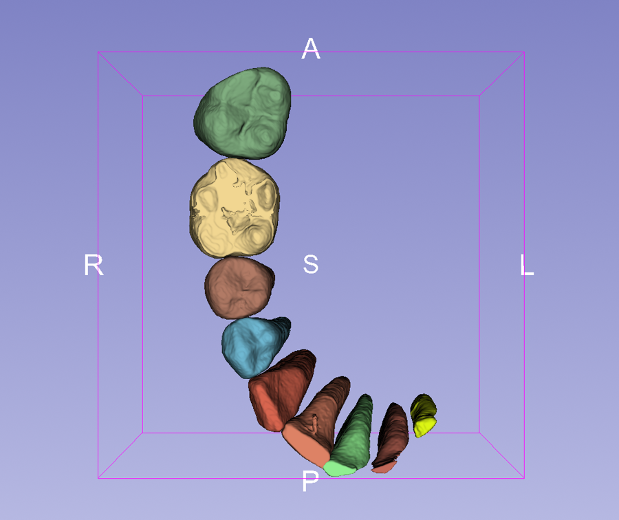

3D teeth segmentation, one segment per tooth with crown and roots, for **Shimadzu inspeXio micro-CT** scans in [3D Slicer](https://www.slicer.org), using the promptable model [nnInteractive](https://github.com/MIC-DKFZ/nnInteractive).

## Pages

1. **[[Tooth segmentation with nnInteractive]]**: setup, one box prompt per tooth, fixing spills with exclusion points, checking the result, and exporting STL surfaces.
2. **[[History of discovery]]**: how the method came about, including what was tried along the way (thresholding, CBCT-trained dental models) and why it did not work on these scans.

## Related

Converting the inspeXio `.cb` slice folder to NRRD, and volume rendering of the teeth, are in the companion repository [Shimadzu-inspeXio-converter-for-3D-Slicer](https://github.com/nobyhata/Shimadzu-inspeXio-converter-for-3D-Slicer) and its [wiki](https://github.com/nobyhata/Shimadzu-inspeXio-converter-for-3D-Slicer/wiki).
