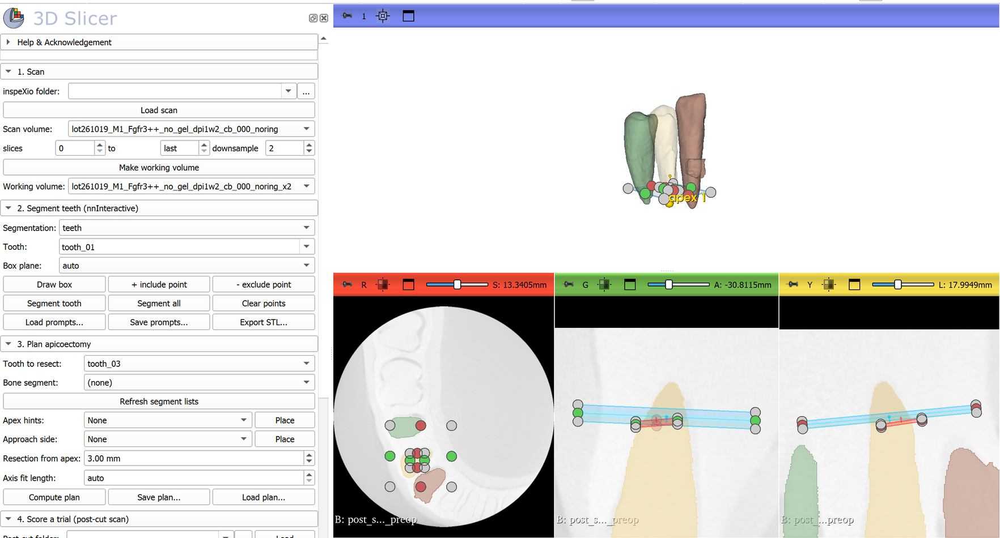

The **InspeXio Teeth** module puts segmentation, apicoectomy planning and the scoring of a cut into one 3D Slicer panel. It was written for bench experiments on a jaw model: scan the model, plan the resection, let the operator cut, scan again, and get the numbers.

In the slice views above, the blue band is the planned resection plane on tooth_04 and the red line is the cut the module measured in the post-cut scan.

## Install

1. 3D Slicer 5.12 with the PyTorch extension and the nnInteractive package, as on [[Tooth segmentation with nnInteractive]].
2. Download or clone the repository.
3. In Slicer, open **Edit → Application Settings → Modules**, add `slicer/InspeXioTeeth` to **Additional module paths**, and restart.
4. The module is under **Segmentation → InspeXio Teeth**.

## 1. Scan

Pick the inspeXio scan folder (the one that holds the `.cb` slices, or any folder above it) and press **Load scan**. The module writes a small `.nhdr` header next to the slices and loads it; the ring-corrected `noring` reconstruction is used when there is one. Set the slice range that contains the teeth, keep **downsample** at 2 for a 12 GB GPU, and press **Make working volume**. Segmentation, planning and scoring all use this working volume.

## 2. Segment teeth

For each tooth:

1. Type a name in **Tooth** (for example `tooth_46`).
2. Press **Draw box** and click two corners on a sagittal or coronal slice through the middle of the tooth, from the crown tip to just past the root apex. Stop the box at the apex. nnInteractive treats the box as the extent of the tooth, so a box that runs into the base pulls the segmentation into it.
3. Press **Segment tooth**.
4. If the tooth spills into the base, press **− exclude point**, click on the spill, right-click to stop placing, and segment again. **+ include point** adds a missed part.

**Save prompts…** writes all boxes and points to a JSON file. **Load prompts…** reads them back, including the voxel-box files used by `nninteractive_teeth.py`, and **Segment all** re-runs every tooth. **Export STL…** writes one surface per tooth.

If you want to score the bone window, add a bone segment with Slicer's Segment Editor (a threshold of the jaw is enough) to the same segmentation.

## 3. Plan the apicoectomy

1. Press **Refresh segment lists**, then choose the **Tooth to resect** and, optionally, the **Bone segment**.
2. For a single-rooted tooth, leave **Apex hints** empty: the module finds the apex at the narrow end of the tooth. For a molar, create a point list, press **Place** and click once near each root apex. Each point becomes one root in the plan.
3. Set **Resection from apex** (3 mm by default). **Axis fit length** is the length of root, measured from the apex, used to fit the root axis; auto uses 5 mm or 40 % of the tooth length, whichever is shorter.
4. Press **Compute plan**.

For each root, the plan contains:

- the apex (yellow point);
- the root axis (yellow line);
- the resection plane (blue), perpendicular to the axis at the set distance and centred on the root's cross-section.

With a bone segment, the plan also has a planned entry point (orange): the point on the outer surface of the jaw nearest to the resection plane centre. Place an **Approach side** point, for example on the buccal side, to restrict the entry to that side. **Save plan…** writes the plan to JSON so the trial can be scored in another session with **Load plan…**.

## 4. Score a trial

1. Scan the model after the cut, load the scan with **Post-cut folder → Load**, and choose it as the **Post-cut scan**.
2. Leave **register to the pre-op scan** on. Use start **Off** when the model went back into the scanner in about the same position; use **useMomentsAlign** if it did not.
3. Fill in the **Trial ID**, **Operator**, **Condition**, **checks** and **time to root exposure**, then choose a **Results CSV**.
4. Press **Score trial**.

The module then:

- registers the post-cut scan rigidly to the pre-op scan, using only the segments and a 1 mm margin around them;
- resamples the post-cut scan onto the pre-op grid;
- finds the removed tooth and bone;
- draws the measured cut face (red) next to the planned plane;
- appends one row per root to the CSV.

| Column | Meaning |
|---|---|
| `level_mm`, `level_error_mm` | Distance from the planned apex to the centre of the cut face, along the planned axis, and its difference from the planned distance |
| `angle_deg` | Angle between the cut face and the planned plane (0° = cut perpendicular to the root axis) |
| `lateral_offset_mm` | Distance of the cut-face centre from the planned axis |
| `apex_removed` | Whether the apex is gone |
| `apical_remnant_mm3` | Tooth left on the apical side of the cut, near this root |
| `wrong_tooth` | Any other tooth that lost more than 0.1 mm³ |
| `removed_target_mm3`, `bone_removed_mm3` | Volumes removed |
| `window_diameter_mm`, `entry_error_mm` | Size of the bone window, and the distance of its centre from the planned entry point |
| `pass_2mm_2checks` | No wrong tooth, entry within 2 mm and at most 2 checks |
| `threshold` | Grey value below which a voxel counted as removed |

A voxel counts as removed only if it was clearly tooth or bone in the pre-op scan and is near the air value afterwards. The root canal and partial-volume edges, which are dark in both scans, never count. Thin dark rims along the tooth surfaces, left by any residual registration error, are ignored. The threshold is set halfway between the tooth and air grey values. If the cut space is filled with water or embedding material instead of air, set **Removed below** by hand.

## Accuracy

The geometry is tested on synthetic teeth in `slicer/InspeXioTeeth/Testing/test_geometry.py`: a two-rooted molar, scanner noise, zero padding, a one-voxel misregistration and a dark root canal. It was also tested in Slicer 5.12.4 on the example scan. That test simulated a cut 8° off perpendicular on tooth_04 and moved the post-cut scan by 0.3 mm and 2°:

- the registration residual was 0.006 mm;
- the measured cut angle was 7.7°;
- no tooth was falsely flagged;
- a deliberate nick on the neighbouring tooth was flagged.

The angle resolution is about the voxel size divided by the root diameter at the cut. That is roughly 1° for a 5 mm root at 0.089 mm, and several degrees for a 1 mm root.

## Licence of the model

nnInteractive's model weights are CC BY-NC-SA 4.0, so research use is fine but not commercial use. Planning and scoring don't use the model, so they also work on teeth segmented any other way.
