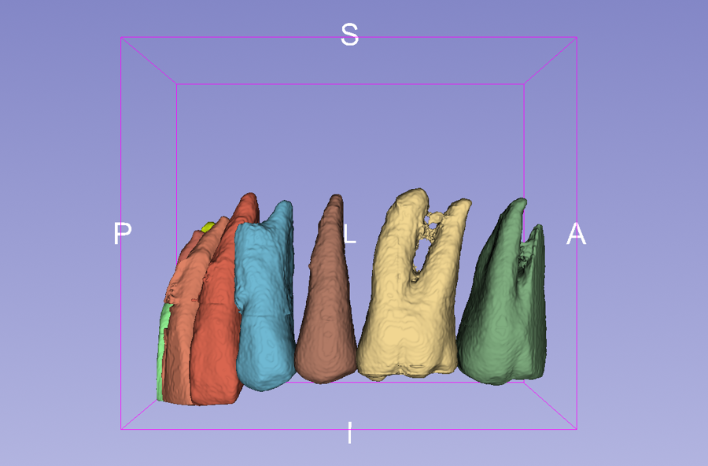
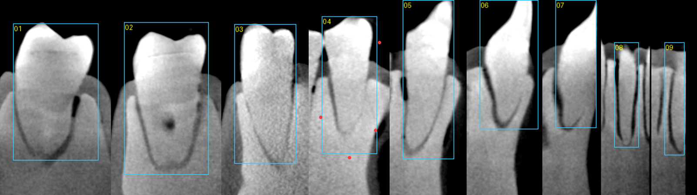
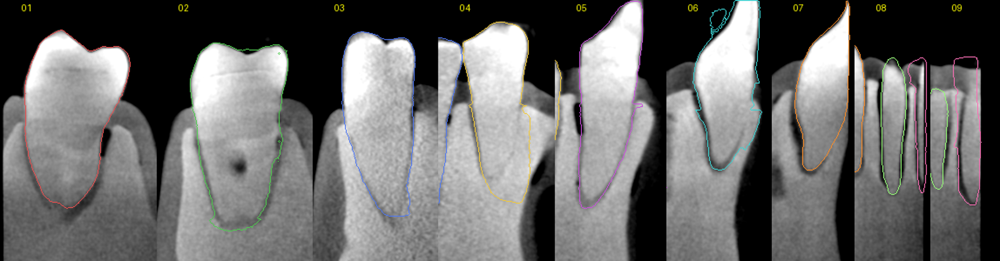
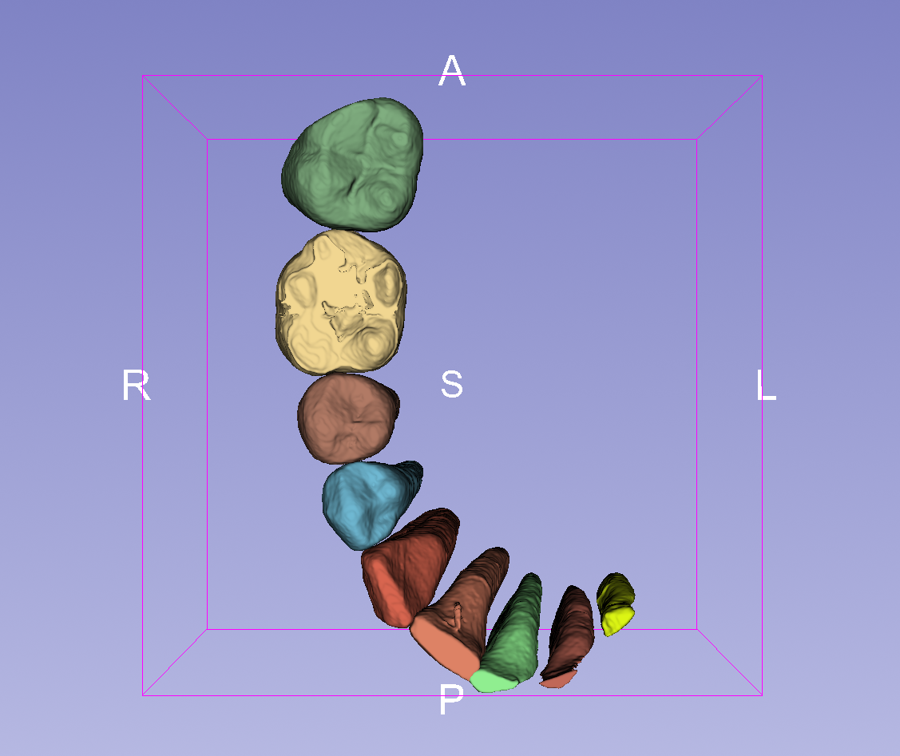
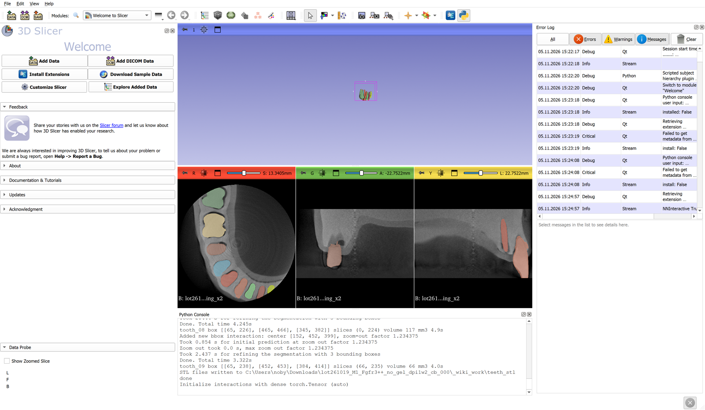

This page shows how to segment **each tooth, crown and roots**, in an inspeXio micro-CT scan and display the teeth as **surface models** in 3D Slicer, using the promptable AI model [nnInteractive](https://github.com/MIC-DKFZ/nnInteractive) (MIC-DKFZ). One box per tooth is usually enough.



## Why nnInteractive

In this specimen the teeth sit in an embedding base of almost the same density as dentin. Only the enamel is clearly brighter, and the roots are separated from the base by a thin dark outline. This rules out the simpler approaches:

- **Thresholding** picks up the crowns (enamel) but cannot follow the roots.
- **CBCT-trained dental models** (for example the CBCTToothSegmentation extension) expect a bright tooth in darker tissue. On this scan they labelled the base as tooth.

nnInteractive was trained on CT, MRI, PET and 3D microscopy and segments whatever object a prompt points at. It follows the dark root outline.

## Requirements

- 3D Slicer 5.12 with the **PyTorch** extension (Extensions Manager), then torch installed once: *PyTorch Utils* module, or in the Python console `import PyTorchUtils; PyTorchUtils.PyTorchUtilsLogic().installTorch()`.
- The nnInteractive Python package, installed in Slicer's Python console:

  ```python
  slicer.util.pip_install("nninteractive")
  ```

- An NVIDIA GPU. It was tested on an RTX 3060 with 12 GB, at 0.089 mm voxels. A CPU works but is slow.
- The model weights download automatically on first use to `~/.nninteractive`. They are licensed **CC BY-NC-SA 4.0** (non-commercial).

> As of November 2026, the SlicerNNInteractive extension was not available in the Extensions Manager for Slicer 5.12.4, so this guide drives the model from a script. Where the extension is available, the same box and point prompts can be drawn by hand in its *nnInteractive Prompts* tab.

## 1. Prepare the volume

Convert the scan with [Shimadzu-inspeXio-converter-for-3D-Slicer](https://github.com/nobyhata/Shimadzu-inspeXio-converter-for-3D-Slicer) and note the slice range that holds the teeth, from crown tips to root apices. For the example scan that is slices 0–600 of the ring-corrected reconstruction. The script averages 2 × 2 × 2 voxels (0.0444 → 0.089 mm). This keeps the root outlines, reduces noise and fits in GPU memory.

## 2. One box per tooth

For each tooth, draw a **2D box on a vertical plane through the middle of the tooth**:

- across the full width of the crown, including both roots of a molar;
- from the **crown tip** down to **just past the root apex**, where the dark outline around the root ends.

The box length matters. nnInteractive treats the box as the extent of the object, so a box that runs far past the apex pulls the segmentation into the base. A box that stops short cuts the root.



Boxes are written as voxel ranges of the downsampled volume, `[[k0, k1], [j0, j1], [i0, i1]]`, with size 1 along the axis of the plane:

```json
"tooth_01": [[36, 246], [71, 72], [103, 233]]
```

To read coordinates, load the downsampled volume (`*_x2`, created by the script) and hover with the **Data Probe**. It shows the voxel position as *(i, j, k)*, the reverse of the order used here.

## 3. Fix a spill with exclusion points

If a tooth leaks into the base, add **negative points** in the leaked region. For example, tooth 04 above needed seven points around the root (the first three are shown here; all are in the example file):

```json
"tooth_04": {"box": [[25, 236], [318, 402], [176, 177]],
             "exclude": [[180, 316, 176], [200, 400, 176], [242, 360, 176]]}
```

`"include"` points work the same way for a part that was missed.

## 4. Run the script

Put the prompts in a `.json` file (see [`examples/teeth_boxes_lot261019.json`](https://github.com/nobyhata/inspeXio-3D-Teeth-Segmentation/blob/main/examples/teeth_boxes_lot261019.json)) and set the paths at the top of `slicer/nninteractive_teeth.py`:

```python
VOLUME_PATH = r"C:\path\to\scan\noring_0000\scan_noring.nhdr"
SLICES      = (0, 600)
TEETH_JSON  = r"C:\path\to\teeth_boxes.json"
EXPORT_DIR  = r"C:\path\to\teeth_stl"      # one STL per tooth, or None
```

Then in **View → Python Console**:

```python
exec(open(r"C:\path\to\nninteractive_teeth.py").read())
```

The first run downloads the model, about a minute. After that, each tooth takes about 3–5 seconds. Each tooth becomes its own segment, keeps only its largest connected piece, and is shown as a smoothed surface.

## 5. Check every tooth

Scroll through each tooth in the slice views and check that the outline follows the dark line around the root. If it doesn't, adjust the box length or add exclusion points and run again. Small touch-ups can also be done in the **Segment Editor** (Paint, Erase, Islands).



## Result on the example scan



| Tooth | Prompt | Volume (mm³) |
|---|---|---|
| 01 | box | 887 |
| 02 | box + 4 exclusion points | 1160 |
| 03 | box | 466 |
| 04 | box + 7 exclusion points | 451 |
| 05 | box | 473 |
| 06 | box | 371 |
| 07 | box | 219 |
| 08 | box | 117 |
| 09 | box | 66 |

The crowns of the front teeth (05–09) extend beyond the scanned volume, so those teeth end flat at the top and their volumes are incomplete.



## Export

With `EXPORT_DIR` set, the script writes one STL per tooth. You can also export from the **Segmentations** module (*Export to files*, STL or OBJ), or as a label map for measurements in *Segment Statistics*.
